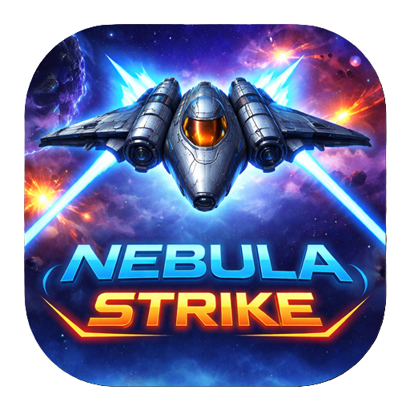

# 🚀 Nebula Strike: Galactic Assault

[](https://github.com/Chinabel/Nebula_Strike)
[](https://developer.mozilla.org/en-US/docs/Web/JavaScript)
[](https://capacitorjs.com/)
[](LICENSE)

**A 2D sci-fi space shooter built with vanilla JavaScript and Capacitor. Battle waves of enemies, defeat bosses, upgrade your ship, and earn rewards on Android.**

<p align="center">
  
</p>

---

## 🎮 Gameplay

- **Wave-based combat** — Survive escalating enemy waves with increasing difficulty
- **4 enemy types** — Normal, Fast, Tank, and Shooter enemies with unique behaviors
- **Boss fights** — Challenging bosses every 3 waves with Spray, Burst, and Laser attack patterns
- **Dynamic difficulty** — Game adapts based on your accuracy and damage taken
- **Auto-shoot system** — Continuous firing with upgradeable weapon patterns (levels 1–5)
- **Touch controls** — Drag-to-move on Android; keyboard arrows on desktop
- **60fps game loop** — Smooth canvas rendering with delta-time capping

---

## ⚡ Features

### Combat & Progression
- 5 weapon upgrade levels — from single shot to 5-bullet spread
- Shield system with upgradeable duration
- Health, Rapid Fire, and Shield power-up drops
- Combo multiplier system
- Revive system via rewarded ads (one per game session)
- Persistent coin economy saved to Firebase Firestore (with localStorage fallback)

### Rewards & Economy
- Daily login reward streak (Days 1–6: coins; Day 7: Mega Chest with weapon + shield upgrade)
- Boss defeat rewards with optional double-reward ad
- Level complete rewards with optional double-reward ad
- Watch-ad-for-coins system
- In-game shop: weapon upgrades, shield upgrades, ship skins

### Ship Skins
- 5 unlockable skins purchasable with in-game coins
- Equipped skin persists across sessions

---

## 🛠️ Tech Stack

| Layer | Technology |
|-------|-----------|
| Game Engine | Vanilla JavaScript (Canvas 2D API) |
| Mobile Wrapper | Capacitor 8 |
| Backend / Sync | Firebase Firestore (native `@capacitor-firebase/firestore`) |
| Ads | `@capacitor-community/admob` 8.0.0 |
| Build Tool | Vite |
| Android Build | Gradle + JDK 21 |
| Audio | HTML5 Audio API |

---

## 📁 Project Structure

```
Nebula_Strike/
├── index.html                  ← Vite entry point (root)
├── vite.config.ts
├── capacitor.config.json
├── package.json
├── public/
│   ├── app.js                  ← Main game file
│   ├── styles.css
│   └── assets/
│       ├── player.png
│       ├── enemy.png
│       ├── boss.png
│       ├── background.png
│       ├── enemies/            ← enemy-fast, enemy-tank, enemy-shooter
│       ├── effects/            ← explosion
│       ├── skins/              ← skin1–skin4
│       ├── sounds/             ← shoot.wav, explosion.wav, menu.mp3, music.mp3
│       └── ui/                 ← coin-icon, health, rapid, shield, hearts
├── www/                        ← Vite build output (Capacitor reads this)
└── android/                    ← Capacitor Android project
```

---

## 🚀 Getting Started

### Prerequisites

- Node.js 22 (via nvm)
- JDK 21
- Android SDK
- Android Studio (for AVD / emulator)

### Environment Setup (Windows)

```cmd
nvm use 22
set JAVA_HOME=C:\Users\<you>\Java\jdk-21
set PATH=%JAVA_HOME%\bin;%PATH%
set ANDROID_HOME=C:\Users\<you>\AndroidSdk
set PATH=%PATH%;%ANDROID_HOME%\platform-tools
```

### Build & Deploy

```cmd
npm run sync:android
cd android
.\gradlew assembleDebug
adb install -r app\build\outputs\apk\debug\app-debug.apk
```

### Dev Server (browser testing)

```cmd
npm run dev
```

---

## 📱 Android Emulator

AVD Name: `NebulaTest` (android-33, google_apis, x86_64)

```cmd
# Start emulator
C:\Users\<you>\AndroidSdk\emulator\emulator -avd NebulaTest -no-snapshot-load

# If device goes offline
adb kill-server
adb start-server
adb devices
```

---

## 🔥 Firebase Setup

- **Android:** Firebase initialized natively via `@capacitor-firebase/firestore` plugin
- **Web:** Firebase Web SDK via CDN with App Check
- Player data stored at Firestore path: `players/{playerId}`
- Coins, weapon level, skins, and daily streak are persisted

---

## 🎯 Game Balance

| Enemy Type | Speed | HP | Reward |
|-----------|-------|-----|--------|
| Normal | Base | Base | 50 coins |
| Fast | Base +2 | Base -1 | 8 coins |
| Tank | Base -1 | Base ×2 | 15 coins |
| Shooter | Base | Base +1 | 12 coins |

Boss spawns every 3rd wave from level 5 onwards. Boss HP scales as `100 + level × 25`.

---

## 📜 License

MIT © Chinabel — see [LICENSE](LICENSE) for details.