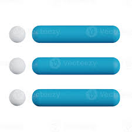

# 🚀 Nebula Strike

[](https://www.android.com)
[](https://kotlinlang.org)
[](https://developer.android.com/about/dashboards)
[](LICENSE)

A fast-paced 3D sci-fi space shooter for Android with stunning OpenGL ES graphics, in-app purchases, and addictive arcade gameplay.


## 🎮 Features

### Core Gameplay
- **Intense 3D Action** - Smooth 60fps OpenGL ES 2.0 graphics
- **Touch Controls** - Intuitive drag-to-move with ship banking physics
- **Procedural Enemies** - Dynamic asteroid generation with rotation
- **Particle Effects** - Explosive visual feedback with glowing particles
- **Parallax Starfield** - Immersive 3D background with depth

### Progression System
- **9 Challenging Levels** - Increasing difficulty with unique layouts
- **Coin Economy** - Earn coins by destroying enemies and completing levels
- **High Score Tracking** - Compete for the best score
- **Level Unlocking** - Progress through the galaxy

### Shop & IAP
- **Dual Currency** - Earn coins in-game or purchase with real money
- **Consumable Power-ups**:
  - 🛡️ Shield Boosters (temporary invincibility)
  - ⚡ Laser Upgrades (enhanced firepower)
- **Permanent Unlocks**:
  - 🚀 Premium Ship (unique design and stats)
  - 📦 Level Pack 2 (levels 4-6)
  - 🚫 Remove Ads (clean experience)

## 📱 Screenshots

| Main Menu | Gameplay | Shop |
|-----------|----------|------|
|  |  |  |

## 🛠️ Tech Stack

- **Language**: Kotlin 1.9+
- **Graphics**: OpenGL ES 2.0
- **Architecture**: Component-based game engine
- **Billing**: Google Play Billing Library 6.1+
- **Persistence**: SharedPreferences
- **Async**: Kotlin Coroutines & Flow

## 🚀 Getting Started

### Prerequisites
- Android Studio Hedgehog (2023.1.1) or newer
- Android SDK 24+ (Android 7.0 Nougat)
- Kotlin plugin enabled

### Installation

1. **Clone the repository**
   ```bash
   git clone https://github.com/yourusername/nebula-strike.git
   cd nebula-strike
